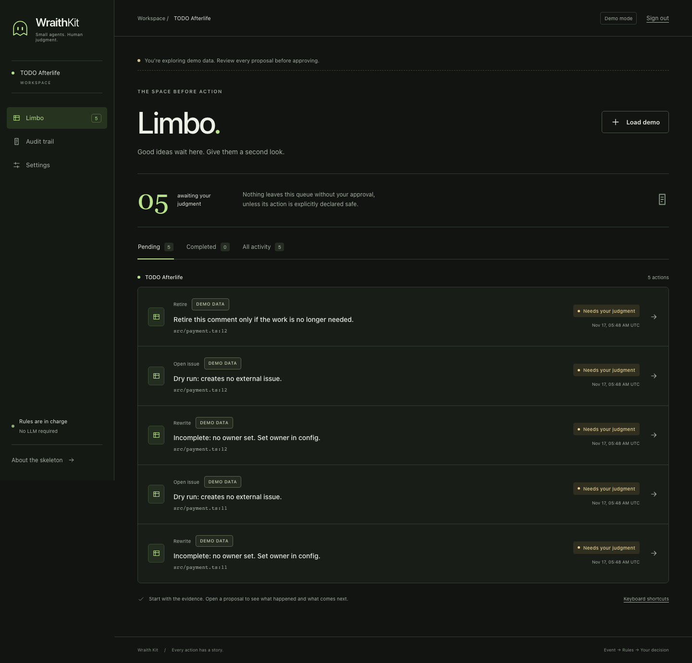
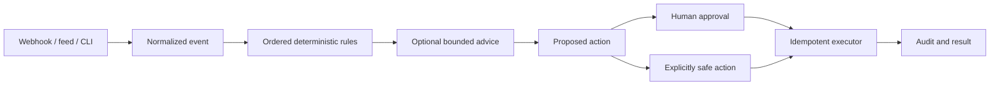

# Wraith Kit

**Small agents. Human judgment.** A TypeScript skeleton that turns webhooks and feeds into explainable proposals, asks before consequential actions, and remembers what happened.

**[Download both apps for judging](https://github.com/himanshu748/wraith-kit/releases/download/kiroween-2026-test/wraith-kit-kiroween-test-build.zip)** · [Release instructions](https://github.com/himanshu748/wraith-kit/releases/tag/kiroween-2026-test) · [Watch the 1:12 walkthrough](https://youtu.be/XldHuxVLAEQ) · [Judge guide](docs/DEVPOST.md) · [Submitted Kiroween entry](https://devpost.com/software/wraith-kit-mrt2yp)

Two working apps demonstrate the same unmodified core:

| App | For | Try it |
|---|---|---|
| [TODO Afterlife](apps/todo-afterlife/README.md) | Developers | Turn a vague TODO into a reviewable patch or a proposed GitHub issue |
| [Notice Ghoul](apps/notice-ghoul/README.md) | Students | Resolve an uncertain deadline, read a daily digest and download a calendar |



## Try the public test build

Download and unzip the release above. With Node.js 22.13 or newer, run the two commands from the extracted directory in separate terminals. The release has no npm install, account or API key requirement.

```sh
node wraith.mjs todo-afterlife
node wraith.mjs notice-ghoul
```

Use the one-time link each command opens. In TODO Afterlife, approve a rewrite and download the patch. In Notice Ghoul, confirm a proposed date and download the calendar from Daily digest. The [recorded browser proof](docs/proof/judge-approval-run.json) documents both artifact downloads and audit results with fictional data.

## Run from source

Use Node 22.13+ (verified on 22.14 and 26.12) and npm. From this directory:

```sh
npm ci
npm run dev:todo
# In a second terminal:
npm run dev:notices
```

The apps listen at **http://127.0.0.1:4317** and **http://127.0.0.1:4318**. Each opens a private one-time login link in your default browser. If opening fails, the terminal prints the owner-only file path containing the link, never the token. Use that link to enter the approval queue.

No account, API key or model is needed. Data marked **Demo data** is fictional. GitHub issue creation defaults to a local dry run. Patches are downloaded for review, never applied automatically. Nothing posts a notice or sends a digest elsewhere.

Read the [five-minute judge journey and local operations guide](docs/local-run.md). To poll an actual local fixture website, follow its two-terminal fixture instructions. Each app README documents live configuration separately.

## What the skeleton provides



One store transaction commits event processing and its audit. Duplicate events retain stable actions. Executors claim leases, retry within limits and use lookup to reconcile uncertain outcomes. An HMAC chain makes unauthorized edits detectable; detecting deletion of a valid tail requires an independently retained checkpoint. Possession of the audit key permits rewriting, so the audit is an inspection aid, not proof that a remote service acted.

The approval UI shows source evidence, rule order, exact preview, dry-run/real-effect disclosure and recorded results. It works without JavaScript; optional keyboard shortcuts start off. The default LLM provider is `none`. One adapter supports an owner-configured Modal endpoint or local Ollama, with deterministic fallback and a durable daily quota. Live providers have not been exercised, and free allowance/model terms must be confirmed before enabling one.

## Shared core, two extensions

```text
skeleton/src/     core, node, aws, llm, ui, mcp, testing
skeleton/template/  scaffold for app number three
apps/todo-afterlife/  GitHub and staged-diff extensions + own README
apps/notice-ghoul/    HTML/RSS/Atom extensions + own README
.kiro/           eight specs, steering, six hooks, custom agents, MCP
scripts/         local runners, replay, bundles, audit, scaffold and hooks
tests/           store contracts, loader integrity, MCP, browser and tooling tests
```

`tests/core-integrity.test.ts` starts each app in a separate Node process and observes loaded modules. It checks public imports, source paths/hashes, identical transformed shared modules, frozen registrations, no copied core and no app identifiers inside the skeleton. Lambda metafiles add bundle proof. This is executable evidence, not an app-reported import list.

Build an extension with `npm run new-app -- your-app-name`, then follow [make your own app in15 minutes](docs/make-your-own-app-in-15-min.md). The generated app includes a runnable example, a test and its own README.

## Tests and evidence

```sh
npm run typecheck
npm run lint
npm test
npm run spec:trace
npm run core:budget
npm run build
npx playwright install chromium   # if Chromium is not already installed
npm run test:e2e
```

The tests include fast-check properties for idempotency, rule ordering, approval and app parsing; real HTTP/browser journeys; a real stdio MCP client; and file-store recovery. For the same store contract against a running local DynamoDB server:

```sh
WRAITH_DYNAMODB_ENDPOINT=http://127.0.0.1:18765 npx vitest run tests/store-contract.test.ts
```

Without that variable, the DynamoDB cases are visibly skipped. They were also run separately against DynamoDB Local. [Verification evidence and limitations](docs/verification.md) separates local, fixture, protocol and untested live-provider outcomes. `npm run guard` checks the staged index and runs required checks before a commit.

## AWS and public URLs

Both apps have SAM templates for Lambda Function URLs, DynamoDB and scheduled ticks. Bundles build and templates pass offline lint. [AWS deployment instructions](docs/aws-deployment.md) explain free-usage checks, secrets and the owner-run commands. The source is public at [github.com/himanshu748/wraith-kit](https://github.com/himanshu748/wraith-kit). The public judge ZIP runs both apps locally without an account or API key. The [Demo verification workflow](https://github.com/himanshu748/wraith-kit/actions/workflows/ci.yml) checks the fixtures and downloads in both local apps and retains browser captures from a successful run.

[Recorded approval proof](docs/proof/judge-approval-run.json) includes both artifact downloads and audited outcomes.

Local state is a small-workload full-snapshot journal, not an unbounded database. AWS active state is capped 1.5 MB. Request caps reduce work but cannot guarantee no charges on a paid AWS account. Automatic demo reset is disabled. Both apps preserved their approval flow when real local Ollama requests timed out. Successful app-level model advice, live GitHub, Modal and account-specific cloud behavior remain unverified. See [provider verification](docs/verification.md#local-provider-check-on-20-nov).

## Built with Kiro, continued honestly

Kiro authored the plan, foundation, hooks, steering, custom agents, MCP configuration and initial requirements. After its usage-limit interruption, Codex continued the requirements and implementation under the user's instruction. [KIRO_USAGE.md](KIRO_USAGE.md) records which surfaces actually ran, experiment evidence, spec/vibe split, PBT, MCP and remaining IDE/power/custom-agent verification. Config files are not presented as proof that those surfaces executed.

[PLAN.md](PLAN.md) maps features to the five judging criteria. The entry targets Skeleton Crew and Best Student: Skeleton Crew, with eligibility and bonus gates in [SUBMISSION_CHECKLIST.md](SUBMISSION_CHECKLIST.md). Drafts: [Devpost story](DEVPOST_STORY.md), [demo recording and shotlist](VIDEO_SHOTLIST.md), [blog](BLOG_DRAFT.md), [social post](SOCIAL_POST.md).

## Pre-existing work

Build additions (all direct dependencies; no app starter template):

| Package | Version | License | Role |
|---|---|---|---|
| `@wraith-kit/skeleton` | 0.1.0 | MIT | First-party workspace package authored here |
| `@aws-sdk/client-dynamodb`, `@aws-sdk/lib-dynamodb`, `@aws-sdk/client-lambda`, `@aws-sdk/client-ssm` | 3.1170.0 | Apache-2.0 | AWS adapters |
| `@modelcontextprotocol/sdk` | 1.32.2 | MIT | Read-only MCP server |
| `zod` | 4.6.7 | MIT | Boundary validation |
| `cheerio` | 1.2.0 | MIT | Notice HTML/XML parser |
| `esbuild` | 0.28.2 | MIT | Lambda bundler |
| `@playwright/test` | 1.65.1 | Apache-2.0 | Browser journeys |
| `@axe-core/playwright` | 4.14.0 | MPL-2.0 | Accessibility checks |
| `ical.js` | 2.2.1 | MPL-2.0 | Independent calendar validation in tests |


Wraith Kit's code is new, written during the Kiroween 2026 Submission Period. No templates, starter kits, fonts or icon packs are used. The repo started empty.

npm packages (every package in `package.json`; versions as installed, from `npm ls --depth=0`; licenses from `npm view <name> license`, both on 16 Nov 2026):

| Item | Version | License | Used for |
|---|---|---|---|
| `@eslint/js` | 10.0.1 | MIT | ESLint's recommended JavaScript rules |
| `@types/node` | 22.20.5 | MIT | Node.js 22 type definitions for TypeScript |
| `eslint` | 10.15.0 | MIT | Linting (`npm run lint`) |
| `fast-check` | 4.10.2 | MIT | Property-based tests |
| `tsx` | 4.23.15 | MIT | Running TypeScript files directly with Node; runs the apps and tooling |
| `typescript` | 6.0.3 | Apache-2.0 | Typechecking (`npm run typecheck`, no emitted files) |
| `typescript-eslint` | 8.72.2 | MIT | TypeScript parser and recommended rules for ESLint |
| `vitest` | 5.1.0 | MIT | Test runner (`npm test`) |

`package-lock.json` pins direct and transitive dependencies. Only adapters/parsers use runtime packages; the core imports Node built-ins and its own files. No template code was copied into either app.

Other pre-existing work and tools:

| Item | Version | License | Used for |
|---|---|---|---|
| Node.js and its built-in modules | v22.14.0 | MIT (Node.js core; bundled third-party parts carry their own licenses, listed in the Node.js LICENSE file) | Runtime for the toolchain, tests and skeleton |
| npm | 10.9.2 | Artistic-2.0 | Installing packages, running scripts |
| The MIT License text | standard text | n/a | `LICENSE`, copied from [choosealicense.com](https://choosealicense.com/licenses/mit/) with the year and holder filled in |
| Kiro CLI, driven over ACP by T3 Code | 3.3.0 (from `kiro-cli --version`) | to confirm | Authored the plan, foundation and initial requirements (see [KIRO_USAGE.md](KIRO_USAGE.md)) |
| Codex harness through T3 Code | Session model gpt-6-astra; harness version not captured | to confirm | Resumed requirements and implemented/tested the apps, shared core, UI and runtime on 17 Nov; not Kiro usage |
| T3 Code | to confirm | to confirm | The app that drives the Kiro CLI session |
| uv and uvx | 0.8.2 (from `uvx --version`, installed with Homebrew) | MIT OR Apache-2.0 (from PyPI's `uv` package metadata) | Running the AWS Documentation MCP server with `uvx`; uvx ran it on Python 3.12.11 |
| `awslabs.aws-documentation-mcp-server` (AWS Documentation MCP server) | 1.2.5 (pinned in `.kiro/settings/mcp.json`) | Apache-2.0 (from PyPI) | The `aws-docs` MCP server Kiro uses to read AWS documentation. uvx installs it and its Python dependencies (45 packages on 16 Nov 2026) into uv's cache, outside this repo |

Additional local verification tools: `cfn-lint` (MIT, version recorded in docs/verification.md), DynamoDB Local 3.3.2 (AWS downloadable developer tool; its bundled license governs use, it is not redistributed), and the installed OpenJDK 25 runtime used to run it. SAM CLI is documented but not installed or used. The original ghost SVG/CSS illustration is authored in this repo; fonts are system UI sans serif, Georgia and system monospace, with no downloaded font assets.

## License

[MIT](LICENSE). Copyright (c) 2026 himanshu748. Built for the [Kiroween 2026 hackathon](https://kiroween.devpost.com/).
